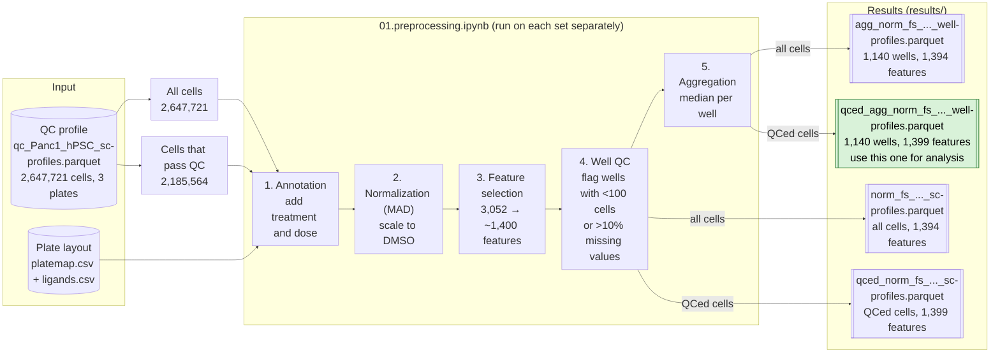

# 2. Preprocessing

This module turns the single-cell measurements into profiles that can be compared across treatments, plates and cell lines. It uses [mantispy](https://github.com/scverse/mantispy).

| Notebook | What it does |
|---|---|
| `01.preprocessing.ipynb` | Annotation, normalization (MAD), feature selection, well QC and aggregation, in that order, on two sets of cells: all cells, and the cells that pass QC. It saves 4 profiles, each with all 3 plates. |

## Overview



The single-cell profiles are saved after well QC, so each cell carries its well's `Metadata_well_qc` flag. The well profiles are the median of those cells. The QCed well profile (green) is the main output.

## Steps

1. **Annotation:** adds each well's compound or ligand and its dose (`Metadata_Perturbation`), and marks the DMSO wells as controls.
2. **Normalization (MAD):** for each plate and cell line, every feature becomes `(value − DMSO median) / (1.4826 × DMSO MAD)`. 0 means "like DMSO".
3. **Feature selection:** drops features normalization could not scale, near-constant features, features missing in over 5% of cells, blocklisted features, features with extreme values (above 500 DMSO spreads), and one of each pair correlated above 0.9. The 4 columns that hold the ID number of a neighboring cell are not used as features.
4. **Well QC:** a well fails if it has fewer than 100 cells or more than 10% missing values. It keeps its profile, flagged `fail` in `Metadata_well_qc` (reason in `Metadata_well_qc_reason`). Only 4 QCed wells fail, all on the 24h CL1 plate (39–89 cells).
5. **Aggregation:** the median of the cells in each well gives one profile per well (1,140 wells).

Each set is normalized and feature-selected on its own, so bad cells never shape the QCed profiles. The two sets therefore keep slightly different features (1,394 and 1,399 of 3,052; 1,326 shared).

## Input

- The QC profile: `../1.quality-control/results/qc_Panc1_hPSC_sc-profiles.parquet` (2,647,721 cells).
- Plate layout: `../../data/metadata/` (`platemap.csv`, `ligands.csv`).

## Results

All results are in `results/`. The prefixes say what was done: **qced** = only cells that pass both image QC and profile QC, **norm** = MAD-normalized, **fs** = feature-selected, **agg** = aggregated per well.

| File | Cells | One row per | Features |
|---|---|---|---|
| `norm_fs_Panc1_hPSC_sc-profiles.parquet` | all (2,647,721) | cell | 1,394 |
| `agg_norm_fs_Panc1_hPSC_well-profiles.parquet` | all | well (1,140) | 1,394 |
| `qced_norm_fs_Panc1_hPSC_sc-profiles.parquet` | pass QC (2,185,564) | cell | 1,399 |
| `qced_agg_norm_fs_Panc1_hPSC_well-profiles.parquet` | pass QC | well (1,140) | 1,399 |

**Use the `qced_` profiles for analysis, and keep the wells where `Metadata_well_qc` is `pass`.** The all-cells profiles keep the QC columns (`Metadata_image_qc`, `Metadata_profile_qc` and their reasons), for comparison or other filters.

In the single-cell profiles, some features are missing in a few cells (at most about 0.1% of cells, mostly cytoplasm features). Fill them in, or drop those cells, before PCA or similar methods. The well profiles have no missing values.

## Run

```bash
sbatch _run.sbatch
```

The job holds 2.6 million cells in memory, so it asks for 400 GB (it uses about 110 GB) and takes about 40 minutes. Logs go to `logs/`.
